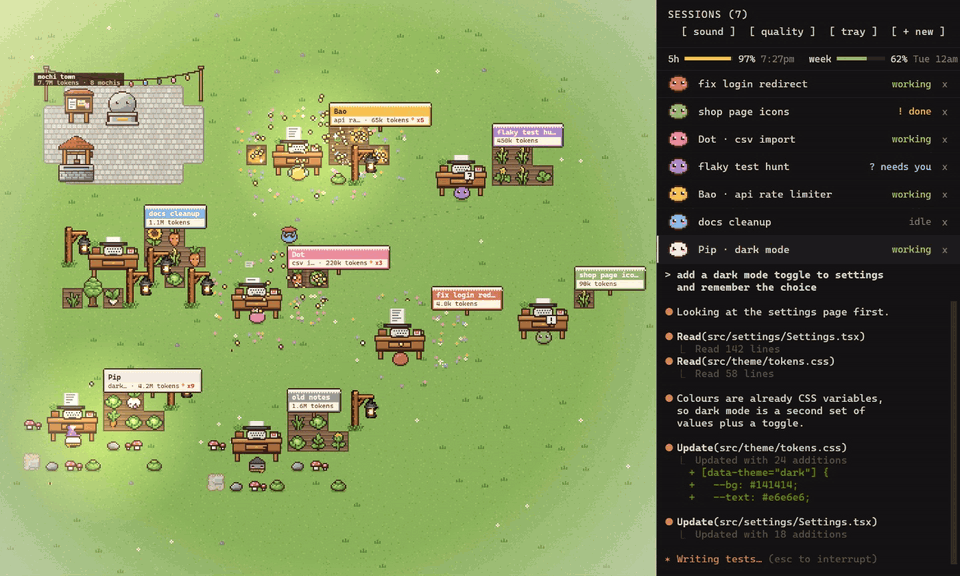
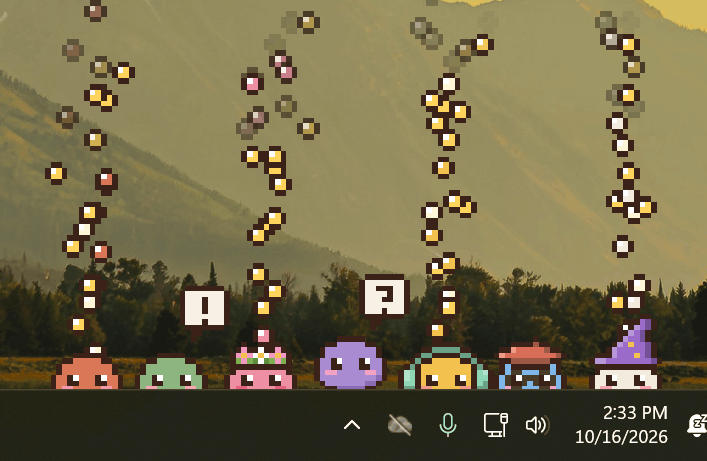
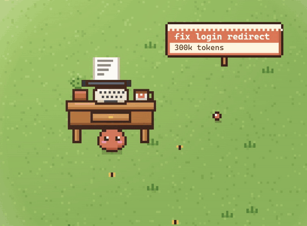

# Mochi Garden

**Your Claude Code sessions, as a little pixel garden.**

Every session you open is a mochi at its own desk. Watch them work, see at a glance who needs you,
and let them spend what they earn on gardens of their own.

## Every session at a glance

A mochi types while its session works, shows `!` when it's done and `?` when it needs you. Click it
to answer a question, approve a permission or send a reply, without hunting through tabs.

## Know when Claude needs you, from any app

Working in something else? Your mochis peek up over the taskbar. Busy ones shake out seeds, and the
one waiting on you bounces with a `?`. Click it and you're straight back in that session.

## Mochis earn coins, and spend them however they like

Every 100 tokens a session uses puts a coin in its wallet. It can buy anything for its garden: a
path, a pond, a blossom tree, a whole shed, a sign that says whatever it wants. It can dress up and
give itself a name too. Or it can ignore all of it.

Nobody tells it to. A session hears once that the garden is there, and that's it. Busy sessions end
up with the grandest gardens, and when one plants a tree, that was its own idea.

## It's just Claude Code

Every tab runs the real `claude` CLI, with your own login, settings and plugins, so nothing about
how you work changes. Nothing leaves your computer either: no account, no tracking, no server.

## Install

1. Install [Claude Code](https://claude.com/claude-code) and sign in (run `claude` once).
2. Download `Mochi.Garden_x.y.z_x64-setup.exe` from [Releases](../../releases/latest) and run it.

Windows 10 and 11. Mochi Garden keeps itself up to date: new versions install once your mochis are
idle, and your sessions come straight back.

## Good to know

- To animate the garden it reads Claude Code's own local files (session transcripts and the session
  list). Its only network request is the update check against this repository. The garden tools are
  served by the app on your machine and can only change the garden.
- Some of what it reads isn't an official Claude Code API, so a Claude Code update can break
  something. Fixes arrive through the updater.
- Your garden lives in `%APPDATA%\MochiGarden`.
- Mochi Garden is an independent project, not affiliated with or endorsed by Anthropic.

Building it yourself: see [DEVELOPING.md](DEVELOPING.md).
